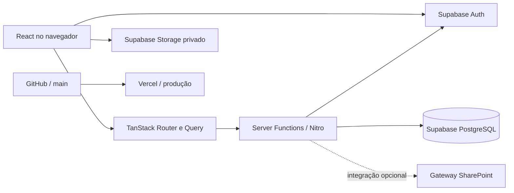

# BF Flow

Plataforma web para gestão de processos, documentos e atividades organizacionais. O produto reúne mapeamento de processos, documentação operacional, modelagem BPMN, cadeia de valor, cadastros corporativos e fluxo de tarefas em um workspace multi-organização.

## Visão técnica

| Camada               | Tecnologia                                              | Uso principal                                         |
| -------------------- | ------------------------------------------------------- | ----------------------------------------------------- |
| Linguagem            | TypeScript 5, modo `strict`                             | Aplicação, regras de domínio e integrações            |
| Interface            | React 19                                                | Componentes e estado de interface                     |
| Framework            | TanStack Start                                          | SSR, funções de servidor e ciclo da aplicação         |
| Rotas                | TanStack Router                                         | Rotas tipadas e baseadas em arquivos                  |
| Dados no cliente     | TanStack Query                                          | Cache, sincronização e invalidação de consultas       |
| Estilos              | Tailwind CSS 4 + CSS modular por domínio                | Design responsivo e tokens visuais                    |
| Banco e autenticação | Supabase                                                | PostgreSQL, autenticação, RLS e Storage               |
| BPMN                 | bpmn-js + bpmn-moddle                                   | Edição, validação, importação e exportação BPMN 2.0   |
| Validação            | Zod                                                     | Validação de entradas nas funções de servidor         |
| Build                | Vite 7 + Nitro                                          | Bundles cliente/SSR e runtime de produção             |
| Hospedagem           | Vercel                                                  | Build e publicação automática a partir da `main`      |
| Qualidade            | ESLint, Prettier, Node Test Runner, PGlite e Playwright | Análise estática, testes de regras, banco e interface |

## Arquitetura



A aplicação usa renderização no servidor e funções de servidor do TanStack Start. O navegador anexa o token Bearer do Supabase às chamadas; o middleware do servidor valida os claims e cria um cliente Supabase no contexto do usuário. Operações administrativas que exigem `service role` ficam restritas ao código de servidor.

O isolamento entre organizações usa `organization_id`, políticas de Row Level Security e verificações adicionais nas regras de domínio. Alterações de banco são versionadas em `supabase/migrations/`.

## Domínios funcionais

- **Página inicial:** indicadores operacionais e atividades do usuário.
- **Minhas tarefas:** solicitações, responsáveis, revisões, reuniões, comentários, anexos, entregas e histórico de eventos.
- **Mapeamento:** diagnóstico e registro estruturado de processos.
- **Documentação:** procedimentos e documentos operacionais com versões.
- **Fluxogramas:** biblioteca e editor BPMN 2.0, importação/exportação, raias, imagens e formatação.
- **Portal de Documentos:** consulta corporativa unificada e somente leitura dos documentos vigentes de Mapeamento, Documentação e Fluxogramas, com pesquisa por metadados, descoberta por contexto e abertura no visualizador de origem.
- **Oportunidades de melhoria:** causas, impactos, ações e prioridades.
- **Cadastros:** processos, áreas, cargos, responsáveis, sistemas, tipos e demais catálogos organizacionais.
- **Cadeia de valor:** estrutura e relacionamento entre processos.
- **Configurações:** identidade visual, modelos documentais, permissões e preferências da organização.

O perfil **ADM** acessa todos os módulos e configurações. **Analista de Processos** pode operar os módulos e cadastros de processo, sem alterar configurações gerais da organização. **Usuário padrão** acessa somente o Portal de Documentos. Grupos de visualização limitam documentos por área e aceitam exceções por documento.

## Persistência e versionamento

- Documentos são armazenados no Supabase e podem possuir snapshots imutáveis em `document_versions`.
- Desenhos BPMN preservam o XML BPMN 2.0, coordenadas BPMN DI, vínculos de raias e metadados próprios do editor.
- Tarefas mantêm eventos de fluxo para auditoria e usam exclusão lógica quando a preservação histórica é necessária.
- Anexos de tarefas ficam em bucket privado, com limite e políticas de acesso definidas nas migrations.
- A integração com SharePoint é opcional e executada no servidor por gateway autenticado.
- Códigos documentais seguem `TIPO.ÁREA.NNN`, por exemplo `POP.ADM.001`, com sequência isolada por organização, tipo e área.

## Estrutura do repositório

| Caminho                      | Responsabilidade                                                     |
| ---------------------------- | -------------------------------------------------------------------- |
| `src/routes/`                | Rotas do TanStack Start; `routeTree.gen.ts` é gerado automaticamente |
| `src/components/`            | Componentes de domínio e interfaces compartilhadas                   |
| `src/components/bpmn/`       | Workspace, editor, biblioteca e estilos BPMN                         |
| `src/lib/`                   | Regras de negócio, funções de servidor, validações e integrações     |
| `src/integrations/supabase/` | Clientes, autenticação e tipos do Supabase                           |
| `supabase/migrations/`       | Evolução versionada do banco, funções SQL, RLS e Storage             |
| `tests/`                     | Testes de domínio, persistência, segurança e navegação               |
| `DESIGN.md`                  | Decisões e padrões atuais de interface                               |
| `UX-CONTRACT.md`             | Regras de consistência de experiência e interação                    |

## Configuração local

Pré-requisitos:

- Node.js compatível com Vite 7.
- Projeto Supabase configurado.
- Credenciais de SharePoint somente quando a integração for utilizada.

```bash
npm ci
npm run dev
```

Use `.env.example` como referência. Nunca envie valores reais de chaves ou tokens ao Git.

| Variável                        | Escopo                                | Obrigatória        |
| ------------------------------- | ------------------------------------- | ------------------ |
| `VITE_SUPABASE_URL`             | Cliente                               | Sim                |
| `VITE_SUPABASE_PUBLISHABLE_KEY` | Cliente                               | Sim                |
| `SUPABASE_URL`                  | SSR e funções de servidor             | Sim                |
| `SUPABASE_PUBLISHABLE_KEY`      | Funções autenticadas                  | Sim                |
| `SUPABASE_SERVICE_ROLE_KEY`     | Operações administrativas no servidor | Conforme o recurso |
| `SHAREPOINT_GATEWAY_URL`        | Integração SharePoint                 | Não                |
| `SHAREPOINT_API_KEY`            | Integração SharePoint                 | Não                |

## Comandos de desenvolvimento

```bash
npm run dev          # servidor local
npm run build        # build cliente, SSR e Nitro
npm run lint         # análise estática
npm run format:check # verificação de formatação
npm test             # suíte completa
npm run test:tasks   # recorte de testes de tarefas
```

O teste de navegação pode iniciar uma aplicação local ou usar uma URL existente:

```bash
npm run smoke:navigation
```

## Segurança

- Tokens são validados no servidor antes das funções protegidas.
- Funções de servidor recebem proteção CSRF.
- Entradas críticas são validadas com Zod e regras SQL.
- A chave `service role` não deve ser importada em componentes, rotas cliente ou arquivos compartilhados.
- RLS é a barreira principal de acesso a dados; filtros na interface não substituem políticas de banco.
- Buckets privados devem validar organização, tarefa, usuário e caminho do objeto.
- Novas migrations devem incluir políticas, índices e testes quando alterarem autorização ou concorrência.

## Convenções de manutenção

- Use imports com o alias `@/` para arquivos em `src/`.
- Crie rotas em `src/routes/`; não edite `src/routeTree.gen.ts` manualmente.
- Mantenha código exclusivamente servidor em arquivos `*.server.ts` ou atrás das proteções do TanStack Start.
- Atualize os tipos do Supabase após mudanças de schema.
- Preserve compatibilidade com registros existentes e faça migrações explícitas de formatos legados.
- Prefira operações idempotentes para salvamento, reserva de códigos e criação de versões.
- Antes de publicar: execute lint, testes pertinentes e build de produção.
- A branch de produção é `main`; o deployment deve corresponder ao commit enviado ao GitHub.

## Publicação

Repositório: [github.com/noriam95/ateliam](https://github.com/noriam95/ateliam)

O projeto Vercel `noriam95/bf-flow-2026` publica automaticamente os commits da branch `main`. Uma entrega só deve ser considerada concluída após o status da Vercel indicar sucesso para o SHA correspondente.
